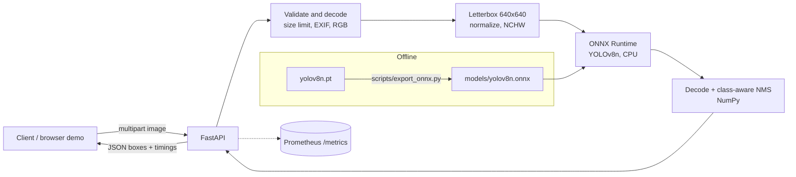

# YOLOv8 Detection API

[](https://github.com/Anshul3977/yolov8-detection-api/actions/workflows/ci.yml)

A production-style object detection service. Pretrained **YOLOv8n** (COCO, 80 classes) is exported to **ONNX** and served with **ONNX Runtime** behind **FastAPI**. PyTorch is only used to export the model and to benchmark against, so the serving image doesn't carry it.

- `POST /detect`: one image in, boxes, labels and confidences out
- `POST /detect/batch`: up to 16 images in **one** forward pass (dynamic batch axis)
- `GET /health`: model and runtime status
- `GET /metrics`: Prometheus metrics (request rate, latency histograms, inference time, detections per class)
- `GET /docs`: OpenAPI UI, and `GET /` is a small browser demo that draws the boxes

## Architecture



Pre- and post-processing are my own NumPy code (letterbox, box decoding, NMS), not the Ultralytics predictor. The raw ONNX output matches PyTorch to within 0.0014 (max absolute difference over the 1×84×8400 output).

## Benchmarks

All numbers were measured on CPU: an 8 vCPU Intel Xeon cloud VM, Python 3.11, torch 2.5.1+cpu, onnxruntime 1.32.0, 640×640 input, 200 timed runs after 20 warm-up runs. The VM was shared with other jobs, so treat the tail numbers (p95) as conservative. Raw JSON is in [`bench/results/`](bench/results/).

### Forward pass: PyTorch vs ONNX Runtime

Both backends get the identical preprocessed tensor and the same thread count.

| Threads | Backend | p50 | p95 | Throughput |
|---|---|---|---|---|
| 1 | PyTorch | 69.1 ms | 77.5 ms | 14.3 fps |
| 1 | **ONNX Runtime** | **51.7 ms** | **56.7 ms** | **19.0 fps** |
| 4 | PyTorch | 31.8 ms | 36.5 ms | 31.0 fps |
| 4 | **ONNX Runtime** | **19.9 ms** | **22.4 ms** | **49.0 fps** |

ONNX Runtime is **1.34× faster at p50 on 1 thread and 1.6× faster on 4 threads**.

Full pipeline on a real 810×1080 photo (decode excluded; letterbox + forward + NMS), ONNX Runtime: p50 54.3 ms on 1 thread, p50 27.2 ms on 4 threads.

### Load test

`bench/loadtest.py` keeps N clients posting `bus.jpg` to `/detect` for 20 s against one uvicorn worker (`ORT_THREADS=4`), with the load generator pinned to separate cores.

| Concurrent clients | Requests/s | p50 | p95 | p99 | Errors |
|---|---|---|---|---|---|
| 1 | 28.9 | 32.3 ms | 41.0 ms | 79.1 ms | 0 |
| 4 | 80.3 | 47.7 ms | 63.6 ms | 114.5 ms | 0 |
| 8 | **90.1** | 84.5 ms | 127.6 ms | 166.5 ms | 0 |

These are end-to-end HTTP numbers, including multipart upload, JPEG decode and JSON.

Reproduce:

```bash
pip install -r requirements-bench.txt --extra-index-url https://download.pytorch.org/whl/cpu
python bench/latency.py --threads 4 --iters 200
uvicorn app.main:app --port 8000 &
python bench/loadtest.py --url http://127.0.0.1:8000 --concurrency 8 --duration 20
```

## Quick start

```bash
pip install -r requirements.txt
uvicorn app.main:app --port 8000
curl -F "file=@tests/assets/bus.jpg" "localhost:8000/detect?conf=0.25"
```

```json
{
  "model": "yolov8n",
  "filename": "bus.jpg",
  "image": {"width": 810, "height": 1080},
  "count": 5,
  "detections": [
    {"class_id": 0, "label": "person", "confidence": 0.8902, "box": {"x1": 670.4, "y1": 380.6, "x2": 809.9, "y2": 879.7}},
    {"class_id": 5, "label": "bus", "confidence": 0.8434, "box": {"x1": 31.5, "y1": 230.7, "x2": 801.4, "y2": 775.8}}
  ],
  "timings": {"preprocess_ms": 2.51, "inference_ms": 16.62, "postprocess_ms": 0.94}
}
```

(Output trimmed to two detections.)

Batch:

```bash
curl -F "files=@tests/assets/bus.jpg" -F "files=@tests/assets/zidane.jpg" localhost:8000/detect/batch
```

### Docker

```bash
docker build -t yolov8-detection-api .
docker run -p 7860:7860 yolov8-detection-api
```

The image installs only `requirements.txt` (ONNX Runtime, no PyTorch) and runs as uid 1000, so the same image works on Hugging Face Spaces.

## Configuration

| Env var | Default | Meaning |
|---|---|---|
| `MODEL_PATH` | `models/yolov8n.onnx` | ONNX model file |
| `CONF_THRESHOLD` | `0.25` | Default confidence threshold (override per request with `?conf=`) |
| `IOU_THRESHOLD` | `0.45` | NMS IoU threshold (`?iou=`) |
| `MAX_DETECTIONS` | `300` | Max boxes per image (`?max_det=`) |
| `MAX_BATCH` | `16` | Max images per `/detect/batch` call |
| `MAX_UPLOAD_MB` | `10` | Per-file upload limit (413 above it) |
| `ORT_THREADS` | `0` (auto) | ONNX Runtime intra-op threads |
| `PORT`, `WORKERS` | `7860`, `1` | Container only |

Errors: 415 for files that aren't images, 413 for files over the size limit or batches that are too large, 422 for bad query parameters.

## Tests and CI

```bash
pip install -r requirements-dev.txt
pytest -v
```

13 tests cover letterbox and NMS, real detections on sample images (a bus and 3+ people in `bus.jpg`), batch-vs-single consistency, threshold filtering, error codes, and the metrics output. GitHub Actions runs the tests, then builds the Docker image and smoke-tests `/health`, `/detect` and `/metrics` against the running container.

## Project layout

```
app/            FastAPI app, ONNX detector, Prometheus metrics, demo page
models/         yolov8n.onnx (exported with dynamic batch axis, opset 17)
scripts/        export_onnx.py, deploy_hf_space.py
bench/          latency.py, loadtest.py, results/*.json
tests/          pytest suite + sample images
deploy/         Hugging Face Space README (front matter)
```

## Deploy to Hugging Face Spaces

```bash
pip install huggingface_hub
HF_TOKEN=<write token> python scripts/deploy_hf_space.py --space <hf-user>/yolov8-detection-api
```

## License

YOLOv8 weights and the Ultralytics export tooling are AGPL-3.0, so this project is AGPL-3.0 too. The sample images in `tests/assets` come from the Ultralytics repository.
